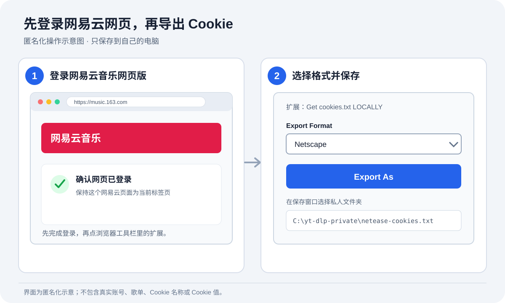

# 故障排查指南

先确认问题发生在哪一步，再按对应的小节处理。不要因为一首歌失败就重跑或删除整个曲库。

Cookie 导出界面示意：

## 1. Cookie 怎么获取

### 使用 Get cookies.txt LOCALLY

1. 用 Chrome 打开网易云音乐网页版并登录。
2. 在当前登录的网易云页面安装 [Get cookies.txt LOCALLY](https://chromewebstore.google.com/detail/get-cookiestxt-locally/cclelndahbckbenkjhflpdbgdldlbecc)。
3. 点 Chrome 工具栏的拼图图标，把扩展固定到工具栏；打开网易云页面后点扩展图标。
4. 在 **Export Format** 选择 **Netscape**，点 **Export As**。
5. 把下载的 `cookies.txt` 移到仓库以外的私人文件夹，可改名为 `netease-cookies.txt`。
6. 在本机 yt-dlp 配置中写入 Cookie 文件路径：

   ```
   --cookies "C:/你的私人文件夹/netease-cookies.txt"
   ```

如果导出的文件里没有网易云 Cookie，回到网易云网页确认仍然登录，并让网易云页面保持为当前标签页后再导出。

### 让 Agent 使用

把 Cookie 文件的**本机完整路径**提供给本机 Agent，并说明要测试的歌单和音乐保存目录。可以直接复制这句话：

```text
Cookie 已用 Get cookies.txt LOCALLY 导出为 Netscape 格式，本机路径是：[完整路径]。
请让 yt-dlp 在本机使用这个文件，先验证一首我有权访问的歌曲，再下载歌单：[歌单链接]，保存到：[音乐目录]。
不要打印、复制或上传 Cookie 内容。已有文件不要重复下载；异常文件先备份再重下。
```

不要把 Cookie 内容贴进聊天。Agent 配置 yt-dlp 只需要 Cookie 文件路径；不要要求 Agent 把认证内容写进仓库。

## 2. 下载出来只有几十秒

网易云可能只返回试听片段，即使命令正常结束也可能发生。

1. 检查 Cookie 路径和浏览器登录状态。
2. 从主音乐目录备份或移走已确认的短文件。
3. 重试这一首或重跑歌单。
4. 检查新文件的时长、大小和标签后，再决定是否清理备份。

曾验证过一首约 30 秒的试听，在有效登录 Cookie 下下载为约 199 秒。每首歌可用的音源不同，仍需逐个核对异常项。

## 3. 已有文件会不会重复下载

配置使用 `--no-overwrites`，且路径包含歌单目录和歌曲 ID。相同歌单再次运行时，已经存在的文件会跳过。

要替换一首试听或损坏文件：先把该文件移到备份目录，再重跑歌单。不同歌单目录中的同一首歌会保留副本，避免一个歌单的标签覆盖另一个歌单。

## 4. 一批歌曲同时失败

如果许多不相关的歌曲突然都连接失败，先检查当前终端继承的代理设置和网络。曾遇到失效的本机代理，导致大型歌单一段歌曲连续失败；恢复直连后重跑，已有文件被跳过。

是否直连应按使用者的网络设置决定，不要为了绕开错误擅自添加代理。

## 5. “No media links found” 或地区限制

这通常表示网易云这次没有提供可播放音源，不一定是配置错误。配置中的 `--ignore-errors` 会让队列继续，因此要看日志并记下失败歌曲 ID，之后再单独尝试。

## 6. 中文文件名异常

不要使用 `--restrict-filenames`，它会把中文字符去掉。使用 `--windows-filenames`，并将配置文件保存为 UTF-8。

## 7. 文件名太长或 Windows 后处理报错

艺人名单很长时，Windows 可能在封面或音频后处理时报错。只针对该歌曲重试，缩短歌手/歌名部分，并保留歌曲 ID：

```
-o "C:/音乐目录/歌单名/短歌手 - 短歌名 [%(id)s].%(ext)s"
```

少数大写 `.MP3` 音源曾在 Windows 改扩展名或写标签时出错。检查对应 ID 的最终文件；若缺失或标签不全，再单曲补跑。

## 8. 歌单链接打不开

优先使用这个标准格式：

```
https://music.163.com/#/playlist?id=歌单ID
```

移动端分享路由 `#/my/m/music/playlist` 可能被 yt-dlp 当成普通网页。保留相同 ID，改成上面的标准格式。

## 9. Cookie 安全与过期

Cookie 相当于登录凭证。只放本机私人目录，不要贴进聊天、提交 GitHub 或发给其他人。仓库只保存示例路径；确认 `.gitignore` 排除了 Cookie 文件。

Cookie 失效时，在 Chrome 重新登录网易云网页，再用扩展导出新文件。不要把 Cookie 值或账号标识发给 Agent。

## 10. 汽水音乐等其他分享页

有些服务的分享页能显示歌单和曲目名称，却没有 yt-dlp 可用的音频地址。若出现 `Unsupported URL`，通用网页提取也失败，就说明当前版本无法直接处理该分享页；网页能显示曲目不代表能下载音频。